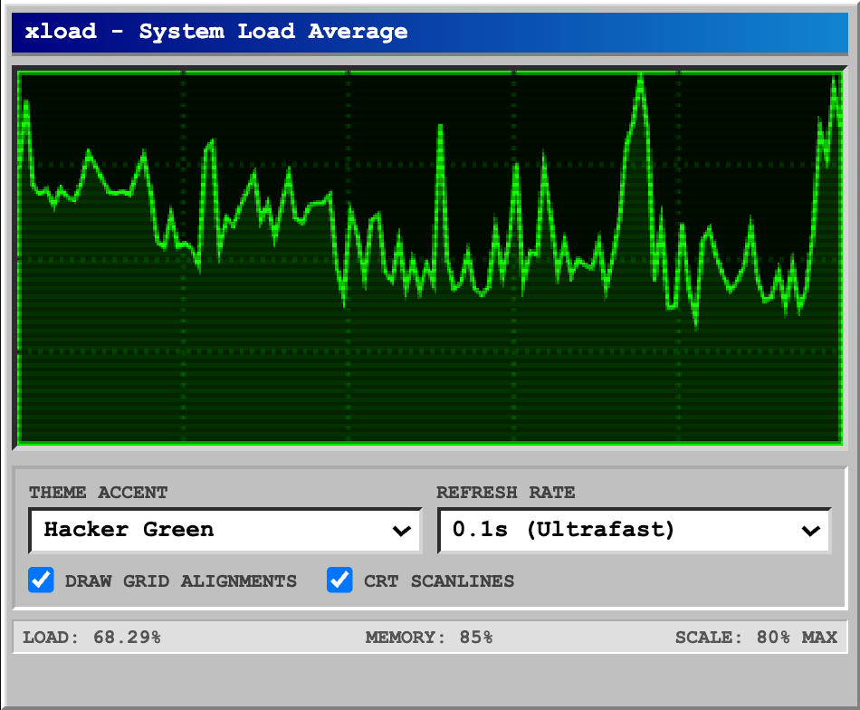

# xload — Retro System Monitor

A tiny Chrome extension that plots your live CPU load in a vintage X11 / `xload`-style window, complete with CRT scanlines and chunky pixel graphics.

This is for people who long for the days of fast, simple applications that were not bloated. No accounts, no telemetry, no dashboards full of half-rendered widgets, no 200 MB of JavaScript to draw a line. It is four small files and a handful of kilobytes of plain JavaScript that does exactly one thing: show you what your CPU is doing — and, in the status bar, how much memory is in use — the way a 1990s workstation would have.

*The screenshot above shows the Hacker Green theme sampling at 0.1s under load, with `LOAD:`, `MEMORY:` and `SCALE:` along the bottom. The default is Classic X11 — a white background with a red trace and black grid — and it is selected out of the box until you pick something else; the other five themes are available from the Theme Accent menu.*

## What it does

Click the toolbar icon and a 400×330 window opens, styled like a Motif-era X11 app: a navy title bar, `xload - System Load Average` in Courier, and a CRT screen carrying the graph, with the characteristic faint scanline overlay. Inside the screen, a continuously scrolling graph shows your total system load. The screenshot at the top runs the Hacker Green theme, but Classic X11 — white paper and a red trace — is what you get on first launch.

The load figure is worked out the honest way — by sampling `chrome.system.cpu.getInfo()` and diffing the user, kernel and idle tick counters against the previous sample across all cores, then dividing active ticks by total ticks. That number is plotted as a filled area graph against an auto-scaling Y axis (rounded up to the nearest 10%, capped at 100%), so a mostly idle machine shows a nearly flat line at the bottom instead of a meaningless full-height wiggle.

Below the graph the status bar carries three readouts: `LOAD:` for the newest CPU sample, `MEMORY:` in the middle for the share of installed RAM in use, and `SCALE:` for the graph's current Y-axis maximum. The memory figure comes from `chrome.system.memory.getInfo()` — total capacity against available capacity, sampled on the same timer as the CPU, so the two readouts move together.

### Features

- **Live CPU load graph** — a rolling 120-point history, so you see the last couple of minutes of behaviour, not just an instantaneous number.
- **Live memory readout** — `MEMORY:` in the centre of the status bar shows the percentage of installed RAM in use, refreshed on the same timer as the graph.
- **Six themes** — Classic X11 (white paper/red line), Phosphor Slate, Amber Monitor, Hacker Green, Neon Cyberpunk, and Monochrome. Each one changes the graph colours, background and fill.
- **Adjustable refresh rate** — from 0.1s (ultrafast) up to 5.0s, so you can trade CPU cost against smoothness. It defaults to 1.0s.
- **Toggleable grid and scanlines** — grid alignment lines for reading values off the graph, and CRT scanlines if you want the full nostalgic experience (or no scanlines if you don't).
- **Remembers your settings** — theme, refresh rate, and toggles persist via `chrome.storage.local`, along with the graph history, so it picks up where it left off.

### What it does not do

- No network requests. The extension holds only the `system.cpu`, `system.memory` and `storage` permissions and never talks to a server.
- No analytics, no accounts, no background sampling while the popup is closed, no build step, no dependencies, no framework.

## Permissions and privacy

xload asks for three permissions, all of which it actually uses:

- **`system.cpu`** — reads the per-core user/kernel/idle tick counters through `chrome.system.cpu.getInfo()`, and nothing else. That is the only way an extension can see system load; it does not expose which applications are running, what they are doing, or any file, window or network activity.
- **`system.memory`** — reads total and available RAM through `chrome.system.memory.getInfo()` to compute the `MEMORY:` percentage. Those two numbers are capacities, not contents: the API cannot see which applications are running, what they hold in memory, or anything about your files or windows.
- **`storage`** — saves your settings and the graph's history with `chrome.storage.local`.

What is stored, and where: a small config object (theme, refresh rate, grid and scanline toggles) and the rolling 120-point load history that lets the graph look continuous when you reopen the popup. Both live in Chrome's extension storage on your own machine. Nothing is uploaded, there is no server to upload to, and the extension has no host permissions, content scripts or remote code. Sampling only runs while the popup is open, so nothing is collected when it is closed.

Removing the extension deletes its storage along with it.

For the full account, including how to report a vulnerability, see [SECURITY.md](SECURITY.md).

## Installing

If it is listed in the Chrome Web Store, install it there. To run your own copy — while the
listing is not live yet, or to work on the code — load it unpacked instead; that takes about
thirty seconds.

### Unpacked install (developer mode)

1. **Get the files.** Clone or download this repository, then unzip it if needed, so the folder containing `manifest.json`, `popup.html`, `popup.js`, `background.js` and the icon files is somewhere permanent. Do not delete or move that folder afterwards — Chrome reads the files from that location every time it starts.

2. **Open the extensions page.** In Chrome, go to `chrome://extensions` in the address bar.

3. **Enable developer mode.** Flip the **Developer mode** toggle in the top-right corner of that page. The "Load unpacked" button appears once it is on.

4. **Load the extension.** Click **Load unpacked** and select the folder that contains `manifest.json` (the folder itself, not a file inside it). The extension appears in the list as *xload Retro System Monitor*.

5. **Pin it.** Click the puzzle-piece icon in the Chrome toolbar, then the pin next to **xload Retro System Monitor**, so the icon stays visible.

6. **Use it.** Click the icon to open the popup and watch the graph build up. On first open there is nothing to plot yet — the extension needs two samples to compute a difference, so give it a second or two before the line appears.

### Notes

- Load is sampled **while the popup is open**. Close the popup and it stops working, which is exactly the point: nothing is running in the background burning the cycles it is supposed to be measuring.
- After changing the code, press the reload icon on the extension's card at `chrome://extensions`, then close and reopen the popup.
- To remove it, click **Remove** on the extension's card, or just delete the folder.
- Because it runs in Chrome's own sandbox, the CPU figures reflect the whole machine, but very short-lived spikes can fall between samples — sample faster (0.1s) if you care about those.
- The figure is an average across every logical core and counts kernel (system) time as load, so one pinned core on a 12-core machine reads about 8%, not 100%.
- `MEMORY:` is `(capacity − availableCapacity) / capacity`, so memory the operating system could reclaim counts as available and the readout does not sit pinned at 100%.
- Cutting a release? The version bump, zip, tag, notes and asset steps are written down in [RELEASING.md](RELEASING.md).

## How it works

- `manifest.json` — Manifest V3 declaration, permissions, popup and service worker wiring.
- `background.js` — a service worker that seeds default settings and an empty history on install.
- `popup.html` — the entire UI and its CSS, styled as an X11 window with a CRT bezel.
- `popup.js` — samples CPU usage and system memory, maintains the rolling history, and draws the graph onto a 2D canvas with smoothing disabled so lines stay crisp and pixelated.

## Requirements

Google Chrome 88 or later: Manifest V3 is supported from Chrome 88, and `manifest.json` declares that as its `minimum_chrome_version`, so Chrome and the Web Store show *Not compatible* instead of installing on anything older. Another Chromium-based browser works if it carries Manifest V3 and the `system.cpu` and `system.memory` APIs. Desktop platforms only — mobile Chrome does not support extensions, and the `system.cpu` and `system.memory` APIs need a real machine to read.

## License

Released into the public domain under the [Unlicense](LICENSE) — no conditions, no warranty. Use it, fork it, change the colours. Attribution appreciated, not required.
